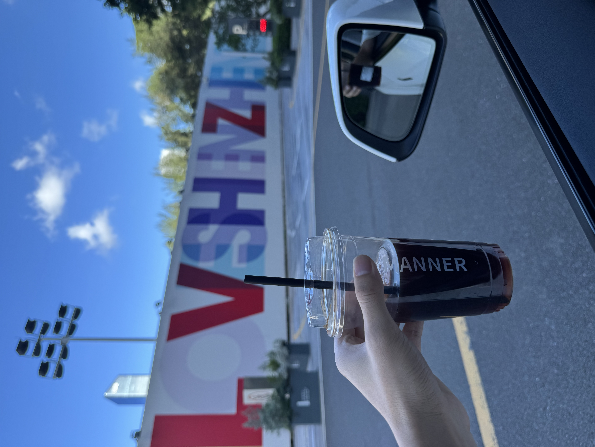

今天是七夕，是跟女朋友约会的日子，也是我职业生涯的 last day。

这两件事，说来你可能觉得八竿子打不着，但机缘巧合，我们共同合作的一款独立开发的 App 「FocusFlight」，却成为了连接一切的起点。

----

很多人可能觉得，独立开发是这两年才火起来的事。AI 兴起之后，谁都可以做点小产品。但我的故事要追溯到八年前。

大一的图书馆，我偶然翻到周楷雯的《*Producter：让产品从0到1*》。那一刻，我突然觉得：

**如果能做出一个 App，全世界的人都能在手机上下载，该有多酷！**

于是我组了一台黑苹果，从0到1开始边学边做自己的产品，尤其是当我听说 Apple 每年会评选一些设计优秀的 App 颁奖，叫做 Apple Design Awards 的时候，觉得得奖的那些 App 更酷了，简直就是 App 界的奥斯卡，那时的我眼里，别的什么都不重要。

直到大学毕业，才有一款小有名气的 App 出现了，叫「文字卡片」，也是我做的第一款可以拿到 Apple 每周编辑推荐的 App。

----

毕业后，我开始了我的打工生涯。

四年打工，我待过大厂（严格且无趣，每天加班到很晚），也待过小团队（自由且灵活，有更多趣味性工作）。区别是挺大，但相同点是：**你始终是在完成别人的目标**。

----

直到 **「FocusFlight」** 出现，它成了我所有经历的汇聚点。说它是 App，其实也是个借口。

借口是什么？

是我们在咖啡店、公园、海边、甚至酒吧，找了无数理由逃离格子间。

是我们证明“灵感不一定诞生在会议室里”，它也可以生长在海风和背景音乐里。

至少比被困在深南大道早高峰里，要浪漫多了。

----

这四年里，也不是没有迷茫的时候。

一方面觉得上班挺没劲的，另一方面又承认它确实很稳定。

直到有一天，我发现那些“不确定”慢慢变成了“可行”。

独立 App 虽然不是什么一夜暴富的故事，但它们足够让我不用再纠结“能不能活下去”，而是开始思考“要怎样活得更自由”。

于是我明白，自己已经走到下一个阶段。

那接下来，终于可以心安理得地去折腾梦想了。

未来见，在路上见。愿每一天都不只是工作日，而是心动日✨。

